# SEAITT e-LMS database

MySQL schema `seaittlms`. The tables are created by the EF Core migrations in `Data/Migrations`, the
model lives in `Data/Entities` and `Data/Configurations`. Table and column names are snake_case.

This version covers **users and roles** and **enrollment** for Senior High School, and it comes with
SEAITT's school data (school year, terms, tracks, strands, schedules, subjects, see
[The school data that comes with the database](#the-school-data-that-comes-with-the-database)).
Lessons, assignments and quizzes come later.

## The database creates itself

Start the app in Development (`dotnet watch`) and it creates every table, or upgrades the tables it already has
**without losing data**. You don't need any SQL file for that. For a diagram of the real database in MySQL Workbench use
*Database > Reverse Engineer...* and pick `seaittlms`.

| File | Use it when |
|---|---|
| [`database/seaittlms_reset_and_rebuild.sql`](../database/seaittlms_reset_and_rebuild.sql) | The database is broken and you want to **start over**. It **erases everything** in `seaittlms` and builds it again. In Workbench: *File > Open SQL Script...*, pick the file, click the lightning bolt. |
| [`database/seaittlms_sample_accounts.sql`](../database/seaittlms_sample_accounts.sql) | You want ready-made sign-ins to try the app: **1 administrator, 1 registrar, 1 guidance counselor, 1 academic coordinator, 1 academic provider, 10 teachers and 20 students** (easy sign-ins: `vargas@legazpi.seaitt.edu.ph` with `Teacher1`, `delacruz@legazpi.seaitt.edu.ph` with `Student1`, ...). It only adds rows (it never deletes), is safe to run again and keeps the rule of one administrator, registrar and guidance counselor; only the password hashes are in the file. They have no enrollment yet. |
| [`database/seaittlms_sample_data.sql`](../database/seaittlms_sample_data.sql) | You want the tables filled with practice data: run it **once**, after the sample accounts. It enrolls the 20 students in four groups of 5 (grade 11 and grade 12, ACAD BUSSENT and TECH-PRO HT1), gives the 10 teachers their courses, and adds the provider's library and what it sent (some opened, some waiting, some posted), modules, activities, quizzes, who opened what, grades, attendance, announcements, messages, friends, groups, files, the security log, the settings and a teacher evaluation. It adds nothing if any of the students is enrolled already. |

The file is generated from the EF migrations (`bash database/export-schema.sh`), so it always matches what the app
creates. It also records the migrations in `__EFMigrationsHistory`, which is why the app doesn't try to create the
tables again afterwards. Add `--all` to the command to also get a script for a new empty schema
(`database/seaittlms_schema.sql`) and one upgrade script per migration (`database/upgrades/`), in case you prefer to
run those in Workbench. They are not kept in the repository.

## Tables

```mermaid
erDiagram
    roles ||--o{ users : "role_id"
    users ||--o| students : "user_id"
    users ||--o| teachers : "user_id"
    users ||--o| registrars : "user_id"
    users ||--o| guidance_counselors : "user_id"
    users ||--o| administrators : "user_id"
    users ||--o| academic_coordinators : "user_id"
    users ||--o| academic_providers : "user_id"

    school_years ||--|{ terms : ""
    school_years ||--o{ sections : ""
    tracks ||--o{ strands : "track_id"
    strands ||--o{ sections : ""
    schedules |o--o{ sections : "meets"
    strands ||--o{ strand_schedules : "runs in"
    schedules ||--o{ strand_schedules : ""
    strands ||--o{ strand_subjects : "curriculum"
    subjects ||--o{ strand_subjects : ""
    teachers |o--o{ sections : "adviser"

    terms ||--o{ enrollments : ""
    sections ||--o{ enrollments : ""
    students ||--o{ enrollments : ""
    users |o--o{ enrollments : "enrolled_by"
    tracks ||--o{ enrollments : ""
    strands ||--o{ enrollments : ""
    enrollments ||--o{ enrollment_subjects : ""
    subjects ||--o{ enrollment_subjects : ""

    teachers ||--o{ teaching_assignments : "teaches"
    sections ||--o{ teaching_assignments : ""
    subjects ||--o{ teaching_assignments : ""
    teaching_assignments ||--o{ modules : ""
    modules ||--o{ module_items : "activity, quiz or task"
    module_items ||--o{ quiz_questions : ""
    module_items ||--o{ submissions : ""
    students ||--o{ submissions : ""
    users ||--o{ calendar_entries : "writes"
    students ||--o{ achievement_awards : "earns"
    modules ||--o{ module_views : "opened by"
    students ||--o{ module_views : ""
    module_items ||--o{ item_views : "opened by"
    students ||--o{ item_views : ""
    material_modules ||--o{ material_deliveries : "sent as"
    teaching_assignments ||--o{ material_deliveries : "to the course"
    modules ||--o| material_deliveries : "the teacher's copy"

    users ||--o| profile_photos : "picture"
    users ||--o{ friendships : "asks / is asked"
    users ||--o{ study_groups : "owns"
    study_groups ||--o{ study_group_members : ""
    study_groups ||--o{ group_posts : ""
    users ||--o{ stored_files : "locker"
    stored_files ||--|| stored_file_contents : "bytes"
    stored_files ||--o{ shared_files : "shared with a person, a group or a course"
    users |o--o{ security_logs : "who"

    students ||--o{ referrals : ""
    teaching_assignments |o--o{ referrals : "subject"
    users |o--o{ referrals : "handled by"
    teaching_assignments ||--o{ attendance_records : ""
    students ||--o{ attendance_records : ""

    users ||--o{ messages : "sender"
    users ||--o{ messages : "recipient"
    users ||--o{ notifications : ""
    users ||--o{ announcements : "author"
    sections |o--o{ announcements : "for the students of"

    tracks |o--o{ students : "summary"
    strands |o--o{ students : "summary"
    subjects |o--o{ students : "summary"
    sections |o--o{ students : "summary"
    tracks |o--o{ teachers : "summary"
    strands |o--o{ teachers : "summary"
    subjects |o--o{ teachers : "summary"
    sections |o--o{ teachers : "summary"
```



### Users and roles

| Table | What it holds |
|---|---|
| `roles` | The seven fixed roles: Admin (1), Teacher (2), Student (3), Registrar (4), GuidanceCounselor (5), AcademicCoordinator (6), AcademicProvider (7). |
| `users` | **Only the login account**: `email` (unique, lower-case), `password_hash`, `phone_number` (E.164, for the future two-factor feature), `role_id`, `is_active`, lockout columns, `security_stamp`. |
| `students`, `teachers`, `administrators`, `guidance_counselors`, `registrars`, `academic_coordinators`, `academic_providers` | Who the person is. One table per role, see below. |

Each person has **one** `users` row and **one** row in the table that matches their role (`user_id` is unique in every
one of those tables). Accounts are created through `UserAccountService`, which inserts both rows in one transaction so
they always match. The Users page (`UserManagementService`) and the enrollment form (`EnrollmentService`) both go through it.

The six role tables have these columns, in this order:

| Table | Columns |
|---|---|
| `administrators`, `guidance_counselors`, `registrars`, `academic_coordinators`, `academic_providers` | `id`, `user_id`, `employee_number`, `first_name`, `middle_name`, `last_name`, `name_extension`, `phone_number`, `status`, timestamps |
| `teachers` | `id`, `user_id`, `employee_number`, `first_name`, `middle_name`, `last_name`, `name_extension`, `grade_level`, `track_id`, `strand_id`, `subject_id`, `section_id`, timestamps |
| `students` | `id`, `user_id`, `lrn`, `first_name`, `middle_name`, `last_name`, `name_extension`, `birth_date`, `sex`, `grade_level`, `track_id`, `strand_id`, `subject_id`, `section_id`, timestamps |

- `first_name` and `last_name` are required, `middle_name` and `name_extension` (Jr., III, ...) are optional.
- `lrn` is the 12-digit Learner Reference Number. `employee_number` is optional and unique when present.
- `phone_number` here is the person's **contact** number. It is separate from `users.phone_number`, which is the number
  for two-factor sign-in later.
- `status` is **Active** or **Inactive** (the working status of the staff member). It is separate from
  `users.is_active`, which is the switch that decides who can sign in. The Users page keeps the two in step: switching
  an account off or on there changes both.
- Registrars got the same columns as administrators and guidance counselors so the three staff roles look alike.

### Grade level, track, strand, subject and section on students and teachers

These five columns are a **quick summary** kept on the person's own row: a student's grade level, track, strand,
section and main subject, or what a teacher mainly handles. All are optional (empty until somebody fills them in).

They are only a summary. The full records are:

- for a **student**, `enrollments` (the section they are in, term by term, with the subjects they take in
  `enrollment_subjects`),
- for a **teacher**, nothing else yet (there is no table for who teaches what). A teacher usually teaches several
  subjects and sections, so the single `subject_id` and `section_id` on `teachers` can only be the main one.

The database makes sure the summary agrees with itself:

- `grade_level` is 11 or 12.
- A strand needs its track, and the strand must belong to that track (`(strand_id, track_id)` is a foreign key to
  `strands (id, track_id)`).
- A section needs its strand and grade level, and all three must match the section (`(section_id, strand_id, grade_level)`
  is a foreign key to `sections (id, strand_id, grade_level)`). So a student can't be in `11-BUSSENT-A` with the EDUC strand.
- Nothing is cascaded: a track, strand, subject or section can't be deleted while a person's summary points at it.

**Enrolling a student** (the registrar page) sets the student's grade level, track, strand and section for you.
`subject_id` stays empty for students on purpose: a student takes several subjects, and they are listed in
`enrollment_subjects`. The summary is **not updated** when a student is moved or promoted by hand in the database.
To fill the summary in for students who were enrolled before this existed, run this once in MySQL Workbench (it leaves
everybody else alone):

```sql
UPDATE students st
JOIN enrollments e ON e.student_id = st.id AND e.status = 'Enrolled'
JOIN terms t ON t.id = e.term_id AND t.is_current = 1
JOIN sections s ON s.id = e.section_id
JOIN strands sd ON sd.id = s.strand_id
SET st.grade_level = s.grade_level,
    st.track_id    = sd.track_id,
    st.strand_id   = s.strand_id,
    st.section_id  = s.id
WHERE st.id > 0;
```

### Academic setup and enrollment

| Table | What it holds |
|---|---|
| `school_years` | `2026-2027`, with start and end dates. |
| `terms` | Terms inside a school year (`term_number` 1, 2, ...). SEAITT uses terms, not semesters. `is_current` marks the running term. |
| `tracks` | The senior high school tracks SEAITT offers: **ACAD** (Academic) and **TECH-PRO** (Technical-Professional) (`code`, `name`, `is_active`). |
| `strands` | BUSSENT, EDUC, ENG, MED, USP (ACAD) and CD1, HT1, HT2 (TECH-PRO) (`code`, `name`). Each strand belongs to one track (`track_id`). |
| `schedules` | When classes meet: **AM** (morning), **MID** (midday), **PM** (afternoon). |
| `strand_schedules` | Which schedules each strand runs in (BUSSENT: AM and PM, HT2: PM only, ...). |
| `subjects` | The subject catalog (`code`, `name`). |
| `strand_subjects` | **The curriculum**: the subjects a strand takes in a grade level and term (`strand_id`, `grade_level`, `term_number`, `subject_id`). The same every school year. |
| `sections` | A section such as 11-BUSSENT-A in one school year: grade level 11 or 12, its schedule (`schedule_id`), optional adviser (teacher). |
| `enrollments` | A student placed in a section for a term, with a copy of who they were then (see below). `status`: Enrolled, Dropped, Completed. |
| `enrollment_subjects` | The subjects a student takes in an enrollment (`enrollment_id`, `subject_id`). |

An **enrollment** row reads on its own. Besides the links to the student, the term and the section, it holds
`lrn`, `first_name`, `middle_name`, `last_name`, `grade_level`, `track_id`, `strand_id` and `subjects` (the subject names
separated by commas, for reading the table; the program uses `enrollment_subjects`). They are copied when the student is
enrolled, so a later change (a new name, a promotion) does not rewrite what was true at the time. The Users page does keep
a student's *name and LRN* in step in their enrollments when an administrator corrects them. `enrolled_by_user_id` is the
registrar who did it.

### Subjects, modules and work

| Table | What it holds |
|---|---|
| `teaching_assignments` | A teacher teaches a subject to a section ("Ms. Reyes teaches BUSINESS ACCOUNTING to 11-BUSSENT-A"). Set by the administrator (Users Management, Teachers, **Subjects**). **A subject of a section has one teacher** (`unique (section_id, subject_id)`). The students who take it are the ones enrolled in that section with that subject (`enrollment_subjects`). |
| `modules` | A lesson of an assignment: `title`, `description`, `body` (the text), `link_url`, `position`. `visible_from_utc` decides who can see it: **empty = draft** (hidden), **a past time = posted**, **a future time = scheduled** (it appears by itself). `notified_at_utc` is set when the students were told. |
| `module_items` | What a student does in a module: `kind` is `Activity`, `Quiz` or `TaskPerformance`, with `max_score`, `due_at_utc`, an optional `visible_from_utc` of its own (empty = with its module) and, for quizzes, `time_limit_minutes`, `shuffle_questions`, `shuffle_options`, **`anti_cheat`**, `max_violations` and `show_result`. |
| `quiz_questions` | The questions of a quiz: `kind` (`MultipleChoice`, `TrueFalse`, `ShortAnswer`), `text`, `options_text` (one choice per line), `correct_answer` (for a short answer several accepted answers separated by `\|`) and `points`. |
| `submissions` | One piece of work per student and item (`unique (item_id, student_id)`): `status` (`InProgress`, `Submitted`, `Graded`), `answer_text` (the plain words), **`answer_html`** (what the student wrote in the editor, with its formatting, `mediumtext`, empty for plain answers; always cleaned by `RichText.Sanitize` before it is saved), `link_url`, `score`, `feedback`, `is_late`. For quizzes also the answers and the order of the questions (`answers_json`), and the anti-cheating watch: `violation_count`, `violation_log`, `is_flagged`, `auto_submit_reason` (`time` or `violations`). |
| `module_views` | That a student has opened a module or a syllabus (so the dashboard can list the ones not opened yet, and the academic provider can see who opened it): `(module_id, student_id)`, `first_opened_at_utc`. |
| `item_views` | That a student has opened the page of an activity, a quiz or a task performance: `(item_id, student_id)`, `first_opened_at_utc`. The academic provider reads it. |
| `attendance_records` | Whether a student came to a subject on a day: `assignment_id`, `student_id`, `attended_on` (the Philippine date), `status` (`Present`, `Late` or `Absent`), `note`. One mark per student, subject and day. Deleted with the subject or the student. |
| `referrals` | A student sent to the guidance counselor: `student_id`, `assignment_id` (the subject; dropped if the subject is removed), `reason` (`FailingGrades`, `AtRisk` or `LowAttendance`), `detail` (what was found, in words), `metric` (the grade or attendance in percent), `status` (`Open`, `InProgress`, `Resolved`), `intervention` (the help given), `notes`, `outcome` (`Improved` or `NoChange`, set when resolved), `resolved_at_utc`, `handled_by_user_id`. Made by the system, worked by the counselor. Deleted with the student. |

Deleting a teacher deletes their assignments, and with them the modules, items and handed-in work. Deleting a student
deletes their work and module views (their enrollments are deleted first, see below). A section or a subject can't be
deleted while an assignment uses it.

A student's own row (`students`) also has `status` (`Active` or `Graduated`; a check constraint allows nothing else), `status_changed_at_utc` and
`status_note`. A graduated student is **archived**: the records stay, the account is switched off (`users.is_active = 0`), the enrollments are
completed and open referrals are resolved. (The withdrawal feature and its table `withdrawal_requests` were removed by the migration
`RemoveWithdrawals`; a student who was `Withdrawn` becomes `Active` again, with the sign-in still switched off.)
The to-do list and its table `todo_items` were removed by the migration `RemoveTodoItems` (the entries people had written are deleted with the table).

### Course materials (the academic provider) and the teacher evaluation (the academic coordinator)

| Table | What it holds |
|---|---|
| `material_modules` | The academic provider's library, per course (`subject_id`): a module (or, with `is_syllabus = 1`, the syllabus, one per course in practice): `title`, `description`, `body`, `link_url`, `position`, `created_by_user_id`. |
| `material_items` | An activity, quiz or task performance of a library module: the same columns as `module_items` (`kind`, `max_score`, a suggested `due_at_utc`, the quiz settings). |
| `material_questions` | The questions of a quiz of the library (same columns as `quiz_questions`). |
| `material_deliveries` | That a library module was sent to a teacher's course: `material_module_id`, `assignment_id` and `module_id` (the teacher's copy, a draft). Unique per library module and course. `sent_by_user_id` is the provider; `created_at_utc` is when it was sent; `opened_at_utc` is when the teacher first opened their copy (its text, one of its activities, or posting it; empty until then). The state shown in Tracking comes from it and from the copy's `visible_from_utc`. It is deleted with the teacher's copy, with the course or with the library module (the copy stays). |
| `teacher_evaluations` | A questionnaire about the teachers: `title`, `instructions`, `sent_at_utc` (empty = draft), `due_at_utc`, `term_id`, `created_by_user_id`. |
| `evaluation_questions` | Its questions: `position`, `text`, `kind` (`Likert`, `Performance`, `Frequency`, `Binary`, `Ranking`, `SelectAll` or `Comment`, checked), `options_text` (the options of a ranking or select-all question, one in each line) and `category` (the area, optional). |
| `evaluation_targets` | The teachers' courses (`assignment_id`) an evaluation was sent about. |
| `evaluation_responses` | A student's answers for one teacher's course: unique per `(evaluation_id, assignment_id, student_id)`, with `submitted_at_utc`. |
| `evaluation_answers` | One answer, per response and question: `rating` (1 to 5, checked; the Likert, Performance and Frequency scales), `selection` (a binary question: `Yes` or `No`; a ranking: the numbers of the options from the best, like `2,0,1`; a select-all: the numbers ticked, like `0,2`) or `comment`. |

`modules.is_syllabus` marks the syllabus of a course (a module without activities). The academic coordinator no longer sends materials: the migration `AddAcademicProviderRoleAndOpenTracking` moved that to the provider (the rows already in the library stay). The coordinator can read the averages and the comments of the evaluation but the screens never show which student wrote an answer: only whether a student has answered (`evaluation_responses`).
Deleting a teaching assignment deletes its targets, answers and deliveries too.

### People, files and the system (round 8)

| Table | What it holds |
|---|---|
| `profile_photos` | The picture of a person (`user_id` is the key): `content_type`, `data` (a small image, at most 256 by 256 pixels), `updated_at_utc` (also the version in the address of the picture). Deleted with the account. |
| `friendships` | A friend request or a friendship: `requester_user_id`, `addressee_user_id`, `status` (`Pending` or `Accepted`, checked), `responded_at_utc`. One row for two people. Saying no, taking it back and unfriending delete the row. |
| `study_groups`, `study_group_members`, `group_posts` | A group (name, description, owner), its members (`group_id`, `user_id`, `joined_at_utc`) and its wall (posts and replies: `parent_post_id`). A group someone made is deleted with the owner's account. A group the **system** makes (`auto_kind` is `GradeStudents`, `CourseStudents` (one strand), `AllStudents`, `GradeTeachers` or `AllTeachers`; `auto_key` says which grade level or strand; `owner_user_id` is empty) is kept up to date by `GroupService.SyncAutomaticAsync`: it adds and removes the members by itself, and nobody can edit or delete it. |
| `stored_files`, `stored_file_contents`, `shared_files` | A file in a person's locker (`owner_user_id`, `name`, `content_type`, `size_bytes`); its bytes in a separate table (a list of files never reads them); and who it is shared with: one person, one group or one teacher's course (exactly one of `shared_with_user_id`, `group_id`, `assignment_id`, kept by `FileService`). |
| `security_logs` | One line of the log: `kind`, `severity`, `user_id` and `actor_user_id` (emptied, not deleted, when the account is deleted), `email`, `actor_name`, `ip_address`, `user_agent`, `details`. |
| `system_settings` | A setting the administrator changed: `key`, `value`, `updated_at_utc`, `updated_by_user_id`. A setting with no row uses its default. |

The migrations `AddProfilePhotos` and `AddSocialFeaturesSecurityLogsAndSettings` add them. (MySQL does not allow a check constraint on a column that has a cascading foreign key, so that two people differ in
`friendships` and that a share has one target are kept by the services, not by the database.) Backups are not in the database: they are SQL files in the `Backups/` folder.

### Files on course materials

| Table | What it holds |
|---|---|
| `attachments` | A file attached to a syllabus or module of the provider's library or a teacher's module (`module_id`, `material_module_id`), or to an activity, quiz or task performance (`item_id`, `material_item_id`): `name`, `content_type`, `size_bytes`, `position`, `uploaded_by_user_id` (emptied when that account is deleted; the file stays). **Exactly one** of the four links is set (`AttachmentService` keeps that; MySQL does not allow a check constraint on columns with a cascading foreign key). Deleted with the module or item it is on. |
| `attachment_contents` | The bytes of a file, one row for each attachment (`attachment_id` is the key), apart from `attachments` so that a list of files never reads them. |

When the provider **sends** a module, its files are copied to the teacher's copy (and the activities' files to the activities of the copy); the teacher's copy is then the teacher's own. A student sees the files of a module
or item they can see (the module is posted and they take the course). Files open in the browser when `FilePreview` allows it (PDF, pictures, text, sound, video), otherwise they download.

### The calendar and the achievements (round 13)

| Table | What it holds |
|---|---|
| `calendar_entries` | An **event a person wrote on their own calendar** (the *Add event* button): `user_id` (the owner, deleted with the account), `title` (at most 120 characters), `day` (a date), `start_time` (a time of day in Philippine time, empty for an all-day event), `notes` (at most 500), `created_at_utc`, `updated_at_utc`. An event is private: `CalendarService` reads and changes only the rows of the signed-in person, and keeps at most 1,000 for a person. Index `(user_id, day)` for the month and week views. |
| `achievement_awards` | **Which achievements a student earned and whether the congratulation box was shown**: `student_id` (deleted with the student), `achievement_key` (`first-step`, `perfect-score`, ... at most 40 characters, not named `key` because that is a MySQL reserved word), `earned_at_utc`, `seen_at_utc` (empty until the student closes the box in the middle of the screen). `unique (student_id, achievement_key)`: an award is written once and shown once. The achievements themselves (their text, progress and whether they are earned **now**) are not in the database: `AchievementService` works them out from the scores, the handed-in work and the opened modules every time, and only writes a row here the first time one is earned. |

The migration `AddCalendarEntriesAndAwards` adds them (down removes them). That makes **55 tables**.

### Messages and notifications

| Table | What it holds |
|---|---|
| `messages` | A message from one account to another: `sender_user_id`, `recipient_user_id`, `body` (up to 2000 characters), `created_at_utc` (when it was sent) and `read_at_utc` (empty while unread). |
| `announcements` | A notice: `author_user_id`, `title`, `body` (up to 2000 characters), `audience` (`Everyone`, `Students` or `Teachers`, checked), `category` (`Exam`, `Holiday`, `SemesterBreak`, `TeachersMeeting` or `Other`, checked; a teacher's class announcement is an `Exam` or `Other`), `section_id` (a teacher's announcement is for the students of one section; empty for the whole audience), `assignment_id` (a teacher's announcement for **one class**, a course of theirs; empty for the others), `expires_on` (the last day it is shown, a Philippine date, or empty). Deleted with its author's account, with its section and with its class. |
| `notifications` | Something the system tells a person under the bell: `user_id`, `kind` (message, module, grade, ...), `title`, `body`, `link` (the page it is about), `is_read`. |

Both are deleted with the account they belong to. Messages can only be sent between 7:00 AM and 7:00 PM Philippine time (those hours can be changed in System Settings)
and only to the roles the sender is allowed to write to (`MessageService`): the database does not check either.

## The school data that comes with the database

The migration `AddSchedulesCurriculumAndEnrollmentDetails` puts this in the tables. It only adds what is missing, so
running it on a database that already has some of it changes nothing that exists.

| Table | Rows |
|---|---|
| `school_years` | 2026-2027 (2026-06-08 to 2027-03-31) |
| `terms` | 1st Term (2026-06-08 to 2026-10-30), 2nd Term (2026-11-02 to 2027-03-31). The 1st Term is marked current, unless another term already was. |
| `tracks` | ACAD (Academic), TECH-PRO (Technical-Professional) |
| `schedules` | AM (Morning), MID (Midday), PM (Afternoon) |

| Strand (`code`) | Full name (`name`) | Track | Schedules | 1st term subjects (grade 11) |
|---|---|---|---|---|
| BUSSENT | Business and Entrepreneurship | ACAD | AM, PM | BUSINESS ACCOUNTING, ADVANCE MATHEMATICS 1 |
| EDUC | Education | ACAD | AM, PM | FILIPINO 1, CREATIVE COMPOSITION 1 |
| ENG | Engineering | ACAD | AM, PM | FINITE MATH 1, EMPOWERMENT TECHNOLOGY |
| MED | Medical and Health Sciences | ACAD | AM, PM | BIOLOGY 1, EMPOWERMENT TECHNOLOGY |
| USP | University Studies Preparatory | ACAD | AM | SOCIAL SCIENCES, BIOLOGY 1 |
| CD1 | Computer System Servicing - Video Game Development (CSS-VGD) | TECH-PRO | AM, PM | COMPUTER SYSTEM SERVICING 1 |
| HT1 | Kitchen Operations - Food and Beverage Services (KO-FBS) | TECH-PRO | AM, MID, PM | KITCHEN OPERATION 1 |
| HT2 | Food and Beverage Services - Kitchen Operations (FBS-KO) | TECH-PRO | PM | FOOD AND BEVERAGE OPERATIONS 1 |

The **2nd term** has the same six subjects for every strand: EFFECTIVE COMMUNICATION, MABISANG KOMUNIKASYON,
GENERAL MATHEMATICS, LIFE AND CAREER SKILLS, GENERAL SCIENCE and PAG-AARAL NG KASAYSAYAN AT LIPUNANG PILIPINO.

Things that were decided for you, change them in the tables if they are not right:

- **The dates** of the school year and the terms are a guess (`school_years`, `terms`).
- **Subject codes** (`BUSACCT`, `ADVMATH1`, `EMPOWERTECH`, ...) were invented, only the names are SEAITT's.
- **Grade 12 has a curriculum**, made up like the grade 11 one: the migration `AddGrade12CurriculumAndSectionsAToC` gives every strand its grade 12 version of the 1st term courses (`BUSINESS ACCOUNTING 2`, ...) and six common courses in the 2nd term. The names and codes are invented, only the pattern is SEAITT's.
- The full names are made by the migration `FillStrandFullNames`: it fills a strand's `name` only while it is still the short code (or the short name CSS-VGD, KO-FBS, FBS-KO),
  so a name the coordinator typed under *Academic setup > Strands* is never overwritten. The first page of the app shows these names. The full names of
  USP and the other strands are the school's to confirm: change them in *Academic setup > Strands* if they are not right.
- An older version of the database had four tracks (ACAD, TVL, SPORTS, ARTS). On upgrade, **TVL became TECH-PRO**
  (kept, with its strands and students), and SPORTS and ARTS were removed if nothing used them (switched off, not
  deleted, if something did).
- USP was first put under TECH-PRO. The migration `MoveUspToAcad` moves it (with the students, teachers and enrollments that list it) to ACAD.
- Sections that were made before schedules existed have an empty `schedule_id`. They keep working.
- The migration `AddSectionsAToE` added sections A to E; **`AddGrade12CurriculumAndSectionsAToC` keeps only A, B and C**: it adds A, B and C at grade 11 and grade 12 for the current school year (the year of the current term, else the latest), for every schedule of every strand, and removes the D and E nobody uses (one with students or a teacher stays). A section that is already there is left alone. The registrar picks the section from this list when enrolling a student (`SectionNames.Choices`).
- The migration `AddAnnouncementCategoriesAndAutomaticGroups` adds `announcements.category` and `assignment_id`, and `study_groups.auto_kind` and `auto_key` (and makes `owner_user_id` optional). `AddEvaluationScales` adds `evaluation_questions.options_text` and `evaluation_answers.selection`; the old `Rating` questions become `Performance` questions (the same 1 to 5). `AddAttachments` adds the two tables `attachments` and `attachment_contents`.
- The migration `AddAcademicProviderRoleAndOpenTracking` adds the role `AcademicProvider` (7), the table `academic_providers`, the table `item_views` and `material_deliveries.opened_at_utc`.
- The migration `AddAcademicCoordinatorRole` adds the role `AcademicCoordinator` (6) and the table `academic_coordinators`; `AddCourseMaterialsAndTeacherEvaluation` adds the tables of the previous section and `modules.is_syllabus`.

## Rules the database enforces

- Email, LRN, employee number, track code and name, strand code, subject code, schedule code and name, and school year name are unique.
- Every strand belongs to **exactly one track**. A track can't be deleted while strands use it.
- An LRN is exactly 12 digits (`ck_students_lrn`), a grade level is 11 or 12, a school year ends after it starts.
- `status` of an administrator, guidance counselor or registrar is `Active` or `Inactive`.
- The grade level, track, strand and section on a student or teacher must agree with each other (see above).
- A student has at most **one enrollment per term** (`unique (student_id, term_id)`).
- An enrollment's strand must belong to its track, and its section must be a section of that strand and grade level
  (composite foreign keys, like the summary on students).
- A section's schedule must be one the strand runs in (`(strand_id, schedule_id)` is a foreign key to
  `strand_schedules`). A section name is unique per school year, strand, grade level and schedule: **A in the AM and A in
  the PM are different sections.**
- A subject appears at most once per strand, grade level and term in the curriculum, and at most once per enrollment.
- An enrollment can only combine a **term and a section of the same school year**. It carries a `school_year_id` that is
  part of two composite foreign keys, to `terms (id, school_year_id)` and to `sections (id, school_year_id)`. When you
  insert one, `school_year_id` must be the school year of both its term and its section.
- A subject of a section has **one teacher** (`unique (section_id, subject_id)` on `teaching_assignments`), a student has one
  piece of work per item (`unique (item_id, student_id)`), `module_items.kind`, `quiz_questions.kind` and
  `submissions.status` are one of their fixed words, `max_score` is above 0 and `score` is 0 or more.
- Deleting an enrollment deletes its `enrollment_subjects`. Otherwise nothing cascades except profile rows when their user
  is deleted. Terms, sections, students, teachers and so on can't be deleted while other rows use them. The Users page
  deletes a student's enrollments first, on purpose, when an administrator confirms; to keep history, switch the account
  off (`is_active = 0`) instead of deleting it.

## Rules the application enforces

- Referrals are made by the system (`ReferralService`, once a minute and when the counselor opens a page): a grade below 70 in a subject
  is *failing*, a grade from 70 up to 75 or three or more missed works is *at risk*, and an attendance rate under 80% over at least 5 marked
  days is *not attending class*. One referral per student, subject and problem; the same problem is not sent again for 14 days after it was
  resolved. Only the guidance counselor works on referrals. Resolving one needs an outcome.
- Graduates are archived by an administrator (`StudentLifecycleService.ArchiveAsync`) **and automatically**: once a day has passed since the end date of the last term of a school year, the background job archives the grade 12 students who have a non-dropped enrollment in that term (`ArchiveFinishedAsync`, note "Graduated: <term> ended (automatic)", one `StudentsArchived` line in `security_logs`; running again changes nothing). A student who is archived can't be enrolled again until an administrator restores the account.
- The formatted answer of a student (`submissions.answer_html`) is the only HTML the application stores that a person typed. `RichText.Sanitize` keeps a fixed list of tags (`p div br hr span b strong i em u s strike del sub sup ul ol li h1..h4 blockquote pre code a table thead tbody tr td th`), only `href` (http/https) on links and `colspan`/`rowspan` on cells, and only these style rules with checked values: font family and size, weight, style, decoration, text and background color, alignment, line height, indents and vertical align. Scripts, frames, pictures, event handlers and everything else are removed; it is run when the answer is saved and again when it is shown.
- A student's subjects are **not picked** at enrollment: `EnrollmentService` gives the student all the active subjects the strand has at that grade level
  and term (`strand_subjects`, edited by the administrator in the school setup). The student's phone number is optional (`users.phone_number`) and an
  existing number is not overwritten. The registrar can **unenroll** a student for the **next term** (the term after the current one): the enrollment in
  that term and its `enrollment_subjects` are deleted. "Not enrolled" means an active student with no `Enrolled` enrollment in the next term (the current term
  when there is no next one), see `Data/Queries/NotEnrolled.cs` and `TermLookup`.
- The school setup (`SchoolSetupService`) is only for administrators and refuses what would leave the records inconsistent: a term, strand or
  section that students use can't move to another school year, track or strand; a schedule a section uses can't be taken from its strand; a school
  year with terms or sections, a track with strands, a subject in a curriculum or taken by students and a section with students can't be deleted; only one term is
  current. (Edits of columns that are part of a key other tables use are made with a direct update, `ExecuteUpdate`, not through a tracked entity.)
- Announcements (`AnnouncementService`): the administrator and the registrar write for everybody, the students or the teachers; a teacher only for a
  section they teach; the administrator may change or delete any, everybody else only their own. People are notified once, when it is posted.
- Only the teacher of a subject marks its attendance, only for students on its roster, and not for a day that has not come
  (`AttendanceService`). The attendance rate is the days present or late divided by the days marked; under 80% is "low".
  The gradebook (`GradebookService`) changes scores through `WorkService.GradeAsync` and checks every box before saving any.
- A teacher can only be given a subject that the section's strand has at the section's grade level, and the student must be
  on the roster (enrolled in the section with the subject) to read a module or hand in work (`TeachingService`,
  `ModuleService`, `WorkService`). Only the teacher of the subject can change its modules, items and scores.
- A quiz is graded when it is handed in; its time limit (and due date) is checked on the server, not only on the screen.
  Questions can't be changed once a student has started the quiz. The background job (`AutomationWorker`, once a minute)
  tells students when a module or an item appears (once each), reminds them 24 hours before a deadline, and hands in
  quizzes whose time ran out.
- Grades are not stored: a subject's grade is the points earned divided by the points possible of the graded work
  (`GradeService`), 70 is the passing mark (`GradeRules.PassingPercent`). Achievements are worked out the same way
  (`AchievementService`). The calendar is built from due dates and posting times (`CalendarService`).
- Only one term should have `is_current = 1` (MySQL has no partial unique index for this).
- A profile row must match the user's role. Use `UserAccountService.CreateAsync` to create accounts.
- The subjects picked for an enrollment must belong to the strand's curriculum for that grade level and term, and at least
  one must be picked when the curriculum has any (`EnrollmentService`).
- Only an active Registrar can enroll students, and only an Administrator can edit, add or delete accounts.
  Nobody can delete or switch off their own account.
- A student's email and password are made from the last name and the LRN (`StudentCredentials`, see the README).
- The summary columns on students and teachers are kept in step by the screens that change them: enrolling a student sets
  the student's, the Users page keeps `status` next to `users.is_active` (its **Status** choice, Active or Inactive, is `users.is_active`; staff who have a `status` column get `Active`/`Inactive` with it; the list can be filtered by it). A teacher's summary has no screen yet.

## Changing the schema

Edit the entities or configurations, then from the repository folder:

```bash
dotnet ef migrations add WhatYouChanged -o Data/Migrations
dotnet ef database update        # or just run the app in Development, it migrates on startup
bash database/export-schema.sh   # regenerates database/seaittlms_reset_and_rebuild.sql
```

Commit the generated files in `Data/Migrations` and the regenerated file in `database/` together with the model
change. Never edit a migration that has already been pushed, add a new one instead.

Things to remember:

- **A migration that moves data** (for example `MovePersonDetailsToRoleTables`, which moved the names from `users`
  into the role tables, or `AddSchedulesCurriculumAndEnrollmentDetails`, which filled the new `enrollments` columns from
  the students and sections) must copy the data before it drops or tightens the old columns. EF's scaffolded
  `DropColumn` would throw the data away, so write that part by hand and test it both ways (`Up` and `Down`) on a
  database that has rows.
- **Column order.** EF adds a new column at the end of the table. To put it somewhere nicer, write the migration's
  `ALTER TABLE ... ADD COLUMN ... AFTER other_column` by hand (see `AddPlacementToStudentsAndTeachers`).
- **Indexes.** MySQL refuses to drop an index that a foreign key still needs (error 1553). In a migration, create the new
  indexes first and drop the old ones after (EF scaffolds them the other way round).
- **Seed data in a migration** must be safe to run twice and must not overwrite what people changed: write it as
  `INSERT ... SELECT ... WHERE NOT EXISTS (...)`, like `SeedSchoolData` does.
- **Views.** Version 1 had `v_...` views. MySQL does not update a view when its tables change, and a broken view makes
  Workbench show *Error loading schema content ... Error Code: 1356*. There are no views now, so if you add one, a
  migration that renames or drops a column it uses must drop and re-create that view.
- **Raw SQL in a migration** (`migrationBuilder.Sql(...)`) must end with a `;`. EF copies it into the `.sql` scripts as it
  is, and without the `;` two statements run together and the script fails in Workbench.
- **Every `UPDATE` or `DELETE` in raw SQL needs a `WHERE` on a key column** (for example `WHERE id > 0`). MySQL Workbench
  has "Safe Updates" on by default and refuses anything else with Error 1175, which stops the script halfway and
  leaves a half-upgraded database. The command-line client does not do this, so test the generated scripts with
  `mysql --init-command="SET SQL_SAFE_UPDATES=1" < file.sql`.
