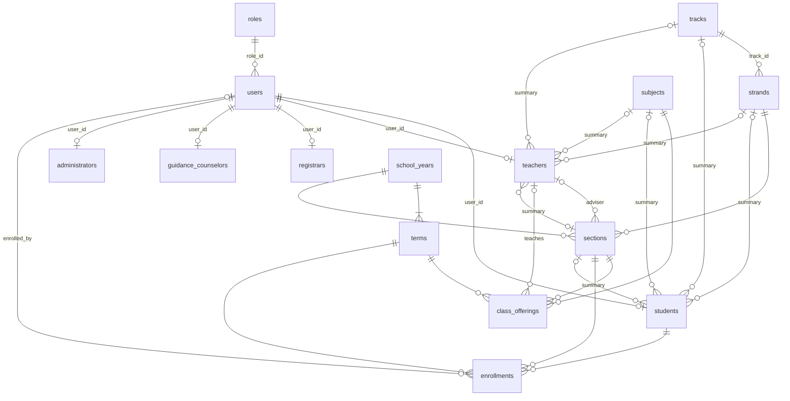

# SEAITT e-LMS database

MySQL schema `seaittlms`. The tables are created by the EF Core migrations in `Data/Migrations`, the
model lives in `Data/Entities` and `Data/Configurations`. Table and column names are snake_case.

This first version covers **users and roles** and **classes and enrollment** for Senior High School.
Lessons, assignments and quizzes come later and will hang off `class_offerings`
(see [What is a class offering?](#what-is-a-class-offering)).

## The database creates itself

Start the app in Development (`dotnet watch`) and it creates every table, or upgrades the tables it already has
**without losing data**. You don't need any SQL file for that. For a diagram of the real database in MySQL Workbench use
*Database > Reverse Engineer...* and pick `seaittlms`.

| File | Use it when |
|---|---|
| [`database/seaittlms_reset_and_rebuild.sql`](../database/seaittlms_reset_and_rebuild.sql) | The database is broken and you want to **start over**. It **erases everything** in `seaittlms` and builds it again. In Workbench: *File > Open SQL Script...*, pick the file, click the lightning bolt. |

The file is generated from the EF migrations (`bash database/export-schema.sh`), so it always matches what the app
creates. It also records the migrations in `__EFMigrationsHistory`, which is why the app doesn't try to create the
tables again afterwards. Add `--all` to the command to also get a script for a new empty schema
(`database/seaittlms_schema.sql`) and one upgrade script per migration (`database/upgrades/`), in case you prefer to
run those in Workbench. They are not kept in the repository.

## Tables



### Users and roles

| Table | What it holds |
|---|---|
| `roles` | The five fixed roles: Admin (1), Teacher (2), Student (3), Registrar (4), GuidanceCounselor (5). |
| `users` | **Only the login account**: `email` (unique, lower-case), `password_hash`, `phone_number` (E.164, for the future two-factor feature), `role_id`, `is_active`, lockout columns, `security_stamp`. |
| `students`, `teachers`, `administrators`, `guidance_counselors`, `registrars` | Who the person is. One table per role, see below. |

Each person has **one** `users` row and **one** row in the table that matches their role (`user_id` is unique in every
one of those tables). Accounts are created through `UserAccountService`, which inserts both rows in one transaction so
they always match.

The five role tables have these columns, in this order:

| Table | Columns |
|---|---|
| `administrators`, `guidance_counselors`, `registrars` | `id`, `user_id`, `employee_number`, `first_name`, `middle_name`, `last_name`, `name_extension`, `phone_number`, `status`, timestamps |
| `teachers` | `id`, `user_id`, `employee_number`, `first_name`, `middle_name`, `last_name`, `name_extension`, `grade_level`, `track_id`, `strand_id`, `subject_id`, `section_id`, timestamps |
| `students` | `id`, `user_id`, `lrn`, `first_name`, `middle_name`, `last_name`, `name_extension`, `birth_date`, `sex`, `grade_level`, `track_id`, `strand_id`, `subject_id`, `section_id`, timestamps |

- `first_name` and `last_name` are required, `middle_name` and `name_extension` (Jr., III, ...) are optional.
- `lrn` is the 12-digit Learner Reference Number. `employee_number` is optional and unique when present.
- `phone_number` here is the person's **contact** number. It is separate from `users.phone_number`, which is the number
  for two-factor sign-in later.
- `status` is **Active** or **Inactive** (the working status of the staff member). It is separate from
  `users.is_active`, which is the switch that decides who can sign in. When you set a person to Inactive, also set
  `users.is_active = 0` so they can no longer sign in. The app does not keep the two in sync yet.
- Registrars got the same columns as administrators and guidance counselors so the three staff roles look alike.

### Grade level, track, strand, subject and section on students and teachers

These five columns are a **quick summary** kept on the person's own row: a student's grade level, track, strand,
section and main subject, or what a teacher mainly handles. All are optional (empty until somebody fills them in).

They are only a summary. The full records are:

- for a **student**, `enrollments` (the section they are in, term by term) and the section's `class_offerings`,
- for a **teacher**, `class_offerings` (every subject they teach to every section). A teacher usually teaches several
  subjects and sections, so the single `subject_id` and `section_id` on `teachers` can only be the main one.

The database makes sure the summary agrees with itself:

- `grade_level` is 11 or 12.
- A strand needs its track, and the strand must belong to that track (`(strand_id, track_id)` is a foreign key to
  `strands (id, track_id)`).
- A section needs its strand and grade level, and all three must match the section (`(section_id, strand_id, grade_level)`
  is a foreign key to `sections (id, strand_id, grade_level)`). So a student can't be in `11-STEM-A` with the ABM strand.
- Nothing is cascaded: a track, strand, subject or section can't be deleted while a person's summary points at it.

The summary is **not updated automatically** when a student is promoted or moved. Whatever screen changes an
enrollment should also update these columns. To fill them in for students who are already enrolled in the current term,
run this once in MySQL Workbench (it leaves everybody else alone):

```sql
UPDATE students st
JOIN enrollments e ON e.student_id = st.id AND e.status = 'Enrolled'
JOIN terms t ON t.id = e.term_id AND t.is_current = 1
JOIN sections s ON s.id = e.section_id
JOIN strands sd ON sd.id = s.strand_id
SET st.grade_level = s.grade_level,
    st.track_id    = sd.track_id,
    st.strand_id   = s.strand_id,
    st.section_id  = s.id
WHERE st.id > 0;
```

### Classes and enrollment

| Table | What it holds |
|---|---|
| `school_years` | `2025-2026`, with start and end dates. |
| `terms` | Terms inside a school year (`term_number` 1, 2, ...). SEAITT uses terms, not semesters. `is_current` marks the running term. |
| `tracks` | The four senior high school tracks: Academic, Technical-Vocational-Livelihood (TVL), Sports, Arts and Design (`code`, `name`, `is_active`). Switch off the ones SEAITT doesn't offer. |
| `strands` | STEM, ABM, HUMSS, GAS, ICT ... (`code`, `name`). Each strand belongs to one track (`track_id`). |
| `subjects` | The subject catalog (`code`, `name`). |
| `sections` | A section such as 11-STEM-A in one school year, grade level 11 or 12, optional adviser (teacher). |
| `class_offerings` | A subject taught to a section during a term by a teacher. This is "the class" (explained below). |
| `enrollments` | A student placed in a section for a term. `status`: Enrolled, Dropped, Completed. |

## What is a class offering?

A class offering is **one class**: *this subject, taught to this section, in this term, by this teacher*.
For example, 1st Term of 2025-2026:

| Section | Subject | Teacher |
|---|---|---|
| 11-STEM-A | General Mathematics | Ms. Reyes |
| 11-STEM-A | Oral Communication | Mr. Santos |
| 11-STEM-B | General Mathematics | Ms. Reyes |

Each row of `class_offerings` is one of these classes. **It is needed, keep it.** It is the complete list that the
summary columns on `students` and `teachers` can only hint at:

- **One teacher teaches many classes and one section has many subjects.** Ms. Reyes has two rows above. A single
  `subject_id` or `section_id` column on `teachers` or `students` can only hold one of them.
- **A student does not pick subjects.** Enrolling a student in a section (`enrollments`) gives them every class of that
  section, so their subject list is always right and can't contradict their section.
- **Lessons, assignments and quizzes belong to one class.** "Quiz 1" is posted to *11-STEM-A General Mathematics*:
  only that section sees it and only Ms. Reyes owns it. These tables will each carry a `class_offering_id`. Without
  `class_offerings` they would have to repeat term, section, subject and teacher everywhere.

The table stays empty until the registrar or an administrator sets up the classes of a term.

## Rules the database enforces

- Email, LRN, employee number, track code and name, strand code, subject code and school year name are unique.
- Every strand belongs to **exactly one track**. A track can't be deleted while strands use it.
- An LRN is exactly 12 digits (`ck_students_lrn`), a grade level is 11 or 12, a school year ends after it starts.
- `status` of an administrator, guidance counselor or registrar is `Active` or `Inactive`.
- The grade level, track, strand and section on a student or teacher must agree with each other (see above).
- A student has at most **one enrollment per term** (`unique (student_id, term_id)`).
- A subject appears at most once per section and term (`unique (term_id, section_id, subject_id)`).
- An enrollment or class offering can only combine a **term and a section of the same school year**. Both
  tables carry a `school_year_id` that is part of two composite foreign keys, to `terms (id, school_year_id)`
  and to `sections (id, school_year_id)`. When you insert one, `school_year_id` must be the school year of
  both its term and its section.
- Nothing cascades except profile rows when their user is deleted. Terms, sections, students, teachers and so
  on can't be deleted while other rows use them. Deactivate users (`is_active = 0`) instead of deleting them.

## Rules the application enforces

- Only one term should have `is_current = 1` (MySQL has no partial unique index for this).
- A profile row must match the user's role. Use `UserAccountService.CreateAsync` to create accounts.
- The summary columns on students and teachers, and `status` next to `users.is_active`, are kept in step by the
  screens that change them (those screens don't exist yet).

## Changing the schema

Edit the entities or configurations, then from the repository folder:

```bash
dotnet ef migrations add WhatYouChanged -o Data/Migrations
dotnet ef database update        # or just run the app in Development, it migrates on startup
bash database/export-schema.sh   # regenerates database/seaittlms_reset_and_rebuild.sql
```

Commit the generated files in `Data/Migrations` and the regenerated file in `database/` together with the model
change. Never edit a migration that has already been pushed, add a new one instead.

Things to remember:

- **A migration that moves data** (for example `MovePersonDetailsToRoleTables`, which moved the names from `users`
  into the role tables) must copy the data before it drops the old columns. EF's scaffolded `DropColumn` would
  throw the data away, so write that part by hand and test it both ways (`Up` and `Down`) on a database that has rows.
- **Column order.** EF adds a new column at the end of the table. To put it somewhere nicer, write the migration's
  `ALTER TABLE ... ADD COLUMN ... AFTER other_column` by hand (see `AddPlacementToStudentsAndTeachers`).
- **Views.** Version 1 had `v_...` views. MySQL does not update a view when its tables change, and a broken view makes
  Workbench show *Error loading schema content ... Error Code: 1356*. There are no views now, so if you add one, a
  migration that renames or drops a column it uses must drop and re-create that view.
- **Raw SQL in a migration** (`migrationBuilder.Sql(...)`) must end with a `;`. EF copies it into the `.sql` scripts as
  it is, and without the `;` two statements run together and the script fails in Workbench.
- **Every `UPDATE` or `DELETE` in raw SQL needs a `WHERE` on a key column** (for example `WHERE id > 0`). MySQL Workbench
  has "Safe Updates" on by default and refuses anything else with Error 1175, which stops the script halfway and
  leaves a half-upgraded database. The command-line client does not do this, so test the generated scripts with
  `mysql --init-command="SET SQL_SAFE_UPDATES=1" < file.sql`.
