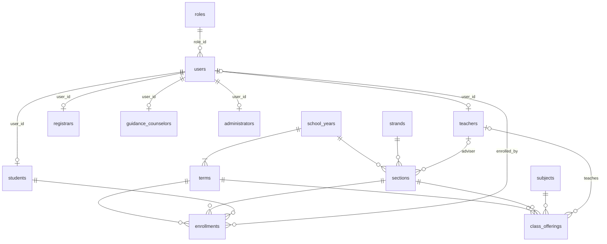

# SEAITT e-LMS database

MySQL schema `seaittlms`. The tables are created by the EF Core migrations in `Data/Migrations`, the
model lives in `Data/Entities` and `Data/Configurations`. Table and column names are snake_case.

This first version covers **users and roles** and **classes and enrollment** for Senior High School.
Lessons, assignments and quizzes come later and will hang off `class_offerings`.

## Tables



### Users and roles

| Table | What it holds |
|---|---|
| `roles` | The five fixed roles: Admin (1), Teacher (2), Student (3), Registrar (4), GuidanceCounselor (5). |
| `users` | The login account for everybody: `email` (unique, lower-case), `password_hash`, `phone_number` (E.164, for the future two-factor feature), name, `role_id`, `is_active`, lockout columns, `security_stamp`. |
| `students` | Student profile: `lrn` (12 digits, unique), `birth_date`, `sex`. |
| `teachers`, `registrars`, `guidance_counselors`, `administrators` | Staff profiles: optional unique `employee_number`. |

Each person has **one** `users` row and **one** profile row in the table that matches their role
(`user_id` is unique in every profile table). Accounts are created through `UserAccountService`, which
inserts both rows in one transaction so they always match.

### Classes and enrollment

| Table | What it holds |
|---|---|
| `school_years` | `2025-2026`, with start and end dates. |
| `terms` | Terms inside a school year (`term_number` 1, 2, ...). SEAITT uses terms, not semesters. `is_current` marks the running term. |
| `strands` | STEM, ABM, HUMSS, GAS, TVL ... (`code`, `name`, optional `track`). |
| `subjects` | The subject catalog (`code`, `name`). |
| `sections` | A section such as 11-STEM-A in one school year, grade level 11 or 12, optional adviser (teacher). |
| `class_offerings` | A subject taught to a section during a term by a teacher. This is "the class". |
| `enrollments` | A student placed in a section for a term. `status`: Enrolled, Dropped, Completed. |

## Rules the database enforces

- Email, LRN, employee number, strand code, subject code and school year name are unique.
- An LRN is exactly 12 digits (`ck_students_lrn`), a grade level is 11 or 12, a school year ends after it starts.
- A student has at most **one enrollment per term** (`unique (student_id, term_id)`).
- A subject appears at most once per section and term (`unique (term_id, section_id, subject_id)`).
- An enrollment or class offering can only combine a **term and a section of the same school year**. Both
  tables carry a `school_year_id` that is part of two composite foreign keys, to `terms (id, school_year_id)`
  and to `sections (id, school_year_id)`. When you insert one, `school_year_id` must be the school year of
  both its term and its section.
- Nothing cascades except profile rows when their user is deleted. Terms, sections, students, teachers and so
  on can't be deleted while other rows use them. Deactivate users (`is_active = 0`) instead of deleting them.

## Rules the application enforces

- Only one term should have `is_current = 1` (MySQL has no partial unique index for this).
- A profile row must match the user's role. Use `UserAccountService.CreateAsync` to create accounts.

## Changing the schema

Edit the entities or configurations, then from the repository folder:

```bash
dotnet ef migrations add WhatYouChanged -o Data/Migrations
dotnet ef database update        # or just run the app in Development, it migrates on startup
```

Commit the generated files in `Data/Migrations` together with the model change.
