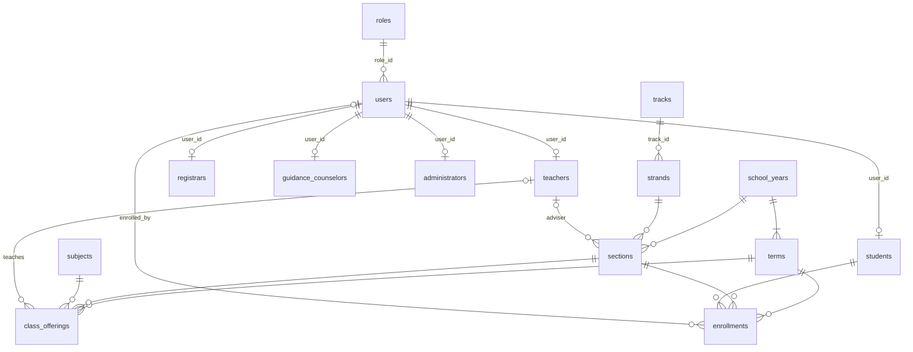

# SEAITT e-LMS database

MySQL schema `seaittlms`. The tables are created by the EF Core migrations in `Data/Migrations`, the
model lives in `Data/Entities` and `Data/Configurations`. Table and column names are snake_case.

This first version covers **users and roles** and **classes and enrollment** for Senior High School.
Lessons, assignments and quizzes come later and will hang off `class_offerings`
(see [What is a class offering?](#what-is-a-class-offering)).

## SQL scripts for MySQL Workbench

| File | Use it when |
|---|---|
| [`database/seaittlms_schema.sql`](../database/seaittlms_schema.sql) | You have a **new, empty** `seaittlms` schema. It creates every table and view. |
| [`database/upgrades/*.sql`](../database/upgrades) | You already created the tables with an older version and want the newest changes **without losing data**. One file per change, run them oldest first. |

In Workbench: *File > Open SQL Script...*, pick the file, click the lightning bolt. To know which upgrades you
need, run `SELECT * FROM __EFMigrationsHistory;` and compare the last row with the file names in `upgrades`.
For a diagram of the real database use *Database > Reverse Engineer...* and pick `seaittlms`.

The files are generated from the EF migrations (`bash database/export-schema.sh`), so they always match what the app
creates. They also record the migrations in `__EFMigrationsHistory`, which is why the app doesn't try to create the
tables again. If you start the app in Development it applies any missing upgrade by itself.

## Tables



### Users and roles

| Table | What it holds |
|---|---|
| `roles` | The five fixed roles: Admin (1), Teacher (2), Student (3), Registrar (4), GuidanceCounselor (5). |
| `users` | The login account for everybody: `email` (unique, lower-case), `password_hash`, `phone_number` (E.164, for the future two-factor feature), name, `role_id`, `is_active`, lockout columns, `security_stamp`. |
| `students` | Student profile: `lrn` (12 digits, unique), `birth_date`, `sex`. |
| `teachers`, `registrars`, `guidance_counselors`, `administrators` | Staff profiles: optional unique `employee_number`. |

Each person has **one** `users` row and **one** profile row in the table that matches their role
(`user_id` is unique in every profile table). Accounts are created through `UserAccountService`, which
inserts both rows in one transaction so they always match.

### Classes and enrollment

| Table | What it holds |
|---|---|
| `school_years` | `2025-2026`, with start and end dates. |
| `terms` | Terms inside a school year (`term_number` 1, 2, ...). SEAITT uses terms, not semesters. `is_current` marks the running term. |
| `tracks` | The four senior high school tracks: Academic, Technical-Vocational-Livelihood (TVL), Sports, Arts and Design (`code`, `name`, `is_active`). Switch off the ones SEAITT doesn't offer. |
| `strands` | STEM, ABM, HUMSS, GAS, ICT ... (`code`, `name`). Each strand belongs to one track (`track_id`). |
| `subjects` | The subject catalog (`code`, `name`). |
| `sections` | A section such as 11-STEM-A in one school year, grade level 11 or 12, optional adviser (teacher). |
| `class_offerings` | A subject taught to a section during a term by a teacher. This is "the class" (explained below). |
| `enrollments` | A student placed in a section for a term. `status`: Enrolled, Dropped, Completed. |

## What you see for each person: the `v_...` views

`users` already stores every person's name, phone number and status. A student's grade level, track, strand,
section and subjects are decided by their **enrollment** and the section's **class offerings**, and what a teacher
teaches is decided by the class offerings. Copying those values into `students` and `teachers` would store the same
fact twice, and the copies would go out of date (a student promoted to Grade 12 would still say 11).

So they are shown by **views**: saved queries that look like tables, are read-only, and are always correct.
Open them in Workbench under *Views* or with `SELECT * FROM v_teachers;`.

| View | Columns |
|---|---|
| `v_administrators`, `v_guidance_counselors`, `v_registrars` | `id`, `user_id`, `employee_number`, `first_name`, `middle_name`, `last_name`, `phone_number`, `status` |
| `v_teachers` | `id`, `user_id`, `employee_number`, `first_name`, `middle_name`, `last_name`, `grade_levels`, `tracks`, `strands`, `subjects`, `sections` |
| `v_students` | `id`, `user_id`, `lrn`, `first_name`, `middle_name`, `last_name`, `grade_level`, `track`, `strand`, `subjects`, `section` |

- `status` is **Active** or **Inactive**. It comes from `users.is_active`, the same switch that decides who can sign in.
- Class details are for the **current term** (the term with `is_current = 1`) and are empty when there is no current term.
- A **teacher** can have many classes, so the teacher columns are comma-separated lists, for example
  `subjects` = `Computer Programming, General Mathematics`.
- A **student's** placement comes from their enrollment with status `Enrolled` in the current term. A student who is
  not enrolled in the current term (or was dropped) has empty class columns. `subjects` lists the subjects of their
  section's classes.
- A section is written as grade-strand-name, for example `11-STEM-A`.
- Views can't be edited. To change a person, edit `users` (name, phone, active) or their enrollment.
- If two terms are flagged current by mistake the views use the newest one. MySQL cuts a list at 1024 characters,
  which is far more than a normal teacher load.

## What is a class offering?

A class offering is **one class**: *this subject, taught to this section, in this term, by this teacher*.
For example, 1st Term of 2025-2026:

| Section | Subject | Teacher |
|---|---|---|
| 11-STEM-A | General Mathematics | Ms. Reyes |
| 11-STEM-A | Oral Communication | Mr. Santos |
| 11-STEM-B | General Mathematics | Ms. Reyes |

Each row of `class_offerings` is one of these classes. The table is needed because:

- **One teacher teaches many classes and one section has many subjects.** Ms. Reyes has two rows above. A single
  `subject` or `section` column on `teachers` or `students` could only hold one of them.
- **A student does not pick subjects.** Enrolling a student in a section (`enrollments`) gives them every class of that
  section, so their subject list is always right and can't contradict their section.
- **Lessons, assignments and quizzes belong to one class.** "Quiz 1" is posted to *11-STEM-A General Mathematics*:
  only that section sees it and only Ms. Reyes owns it. These tables will each carry a `class_offering_id`. Without
  `class_offerings` they would have to repeat term, section, subject and teacher everywhere.

The table stays empty until the registrar or an administrator sets up the classes of a term.

## Rules the database enforces

- Email, LRN, employee number, track code and name, strand code, subject code and school year name are unique.
- Every strand belongs to **exactly one track**. A track can't be deleted while strands use it.
- An LRN is exactly 12 digits (`ck_students_lrn`), a grade level is 11 or 12, a school year ends after it starts.
- A student has at most **one enrollment per term** (`unique (student_id, term_id)`).
- A subject appears at most once per section and term (`unique (term_id, section_id, subject_id)`).
- An enrollment or class offering can only combine a **term and a section of the same school year**. Both
  tables carry a `school_year_id` that is part of two composite foreign keys, to `terms (id, school_year_id)`
  and to `sections (id, school_year_id)`. When you insert one, `school_year_id` must be the school year of
  both its term and its section.
- Nothing cascades except profile rows when their user is deleted. Terms, sections, students, teachers and so
  on can't be deleted while other rows use them. Deactivate users (`is_active = 0`) instead of deleting them.

## Rules the application enforces

- Only one term should have `is_current = 1` (MySQL has no partial unique index for this).
- A profile row must match the user's role. Use `UserAccountService.CreateAsync` to create accounts.

## Changing the schema

Edit the entities or configurations, then from the repository folder:

```bash
dotnet ef migrations add WhatYouChanged -o Data/Migrations
dotnet ef database update        # or just run the app in Development, it migrates on startup
bash database/export-schema.sh   # regenerates database/seaittlms_schema.sql
```

Commit the generated files in `Data/Migrations` and the regenerated files in `database/` together with the model
change. Never edit a migration that has already been pushed, add a new one instead.

Two things to remember:

- **Views.** The `v_...` views read `users`, the five profile tables, `terms`, `class_offerings`, `enrollments`,
  `sections`, `strands`, `tracks` and `subjects`. MySQL does not update a view when its tables change, so a migration
  that renames or drops a column a view uses must drop and re-create that view (see
  `AddTracksAndRoleViews`).
- **Raw SQL in a migration** (`migrationBuilder.Sql(...)`) must end with a `;`. EF copies it into the `.sql` scripts as
  it is, and without the `;` two statements run together and the script fails in Workbench.
