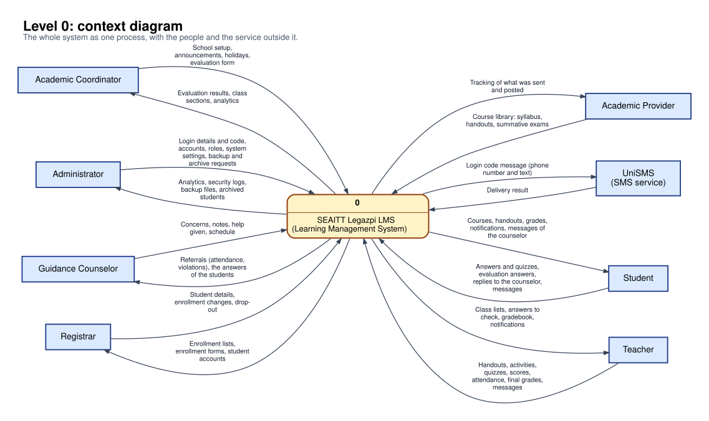
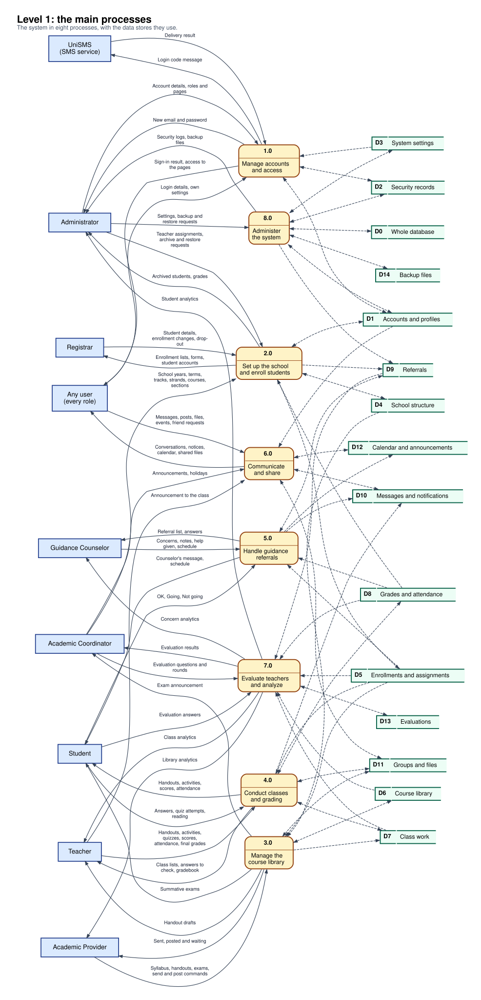
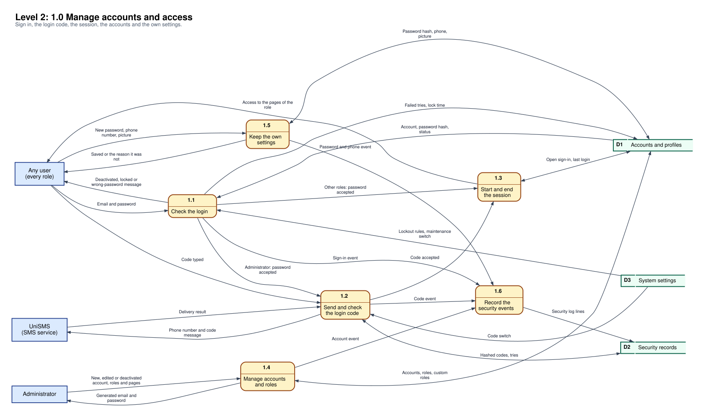
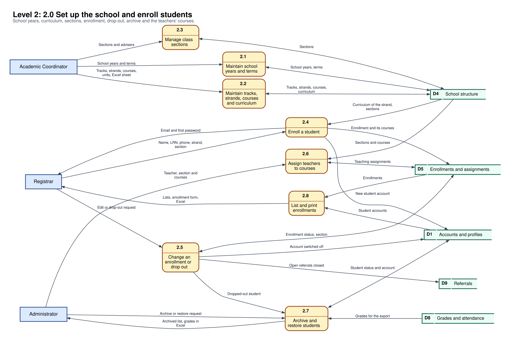
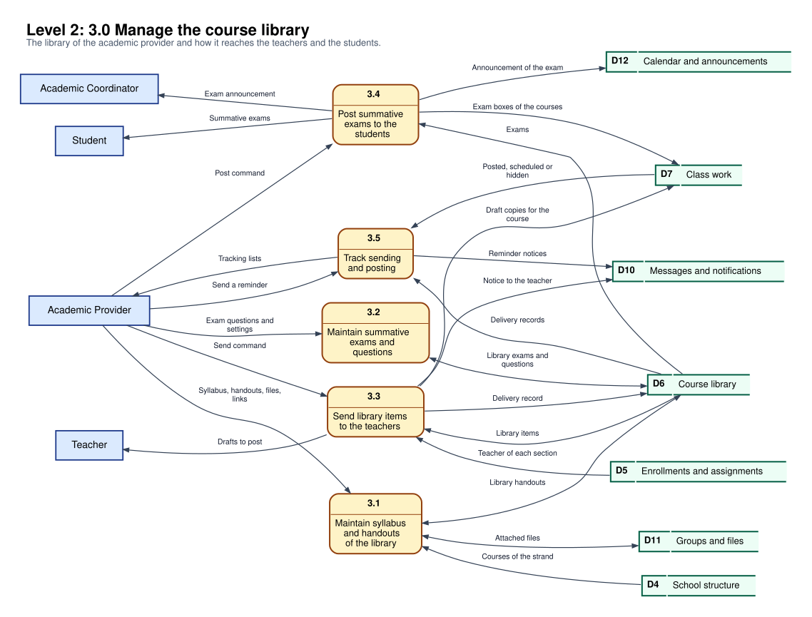
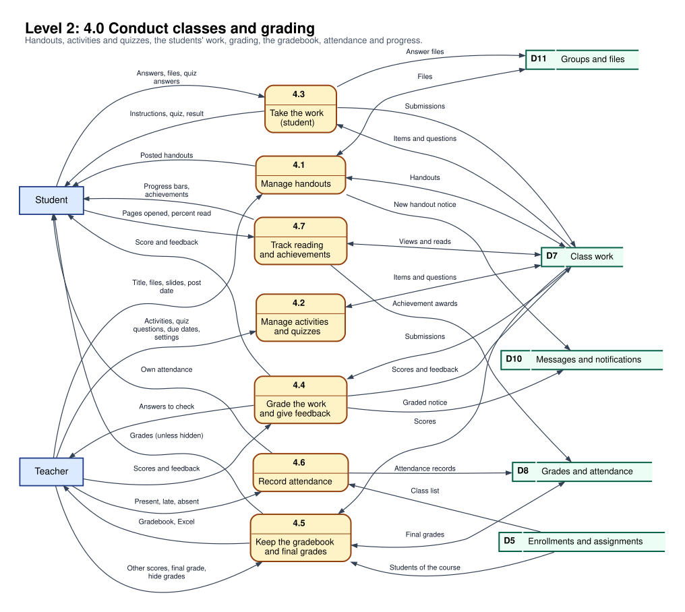
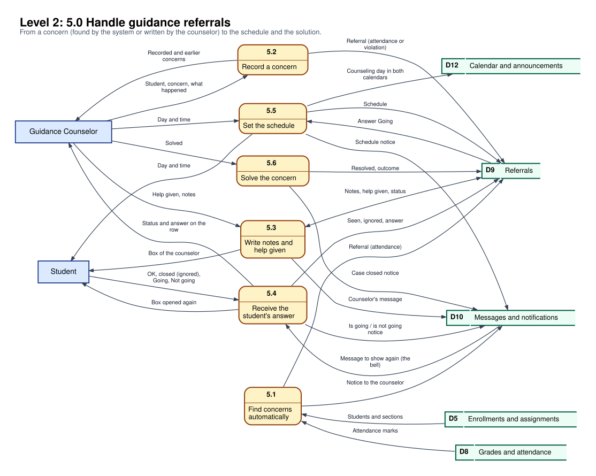
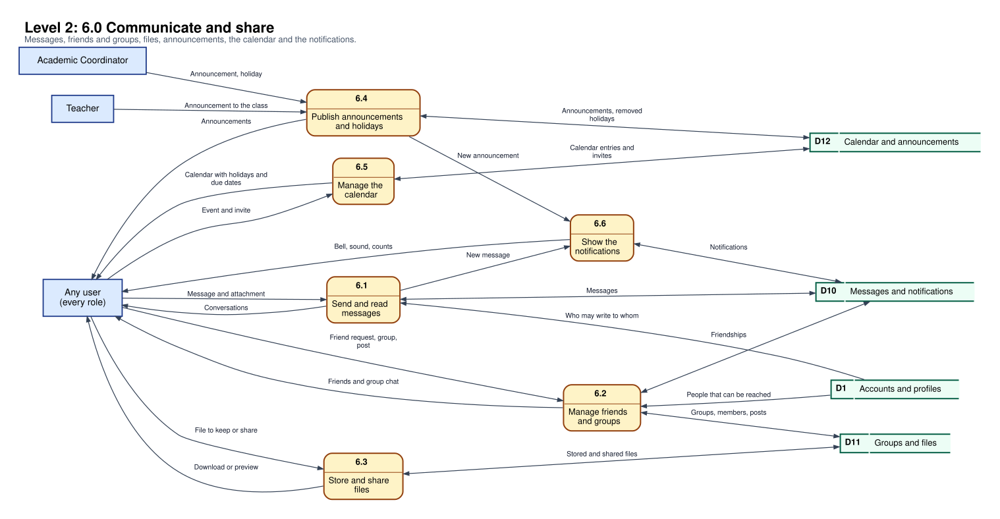
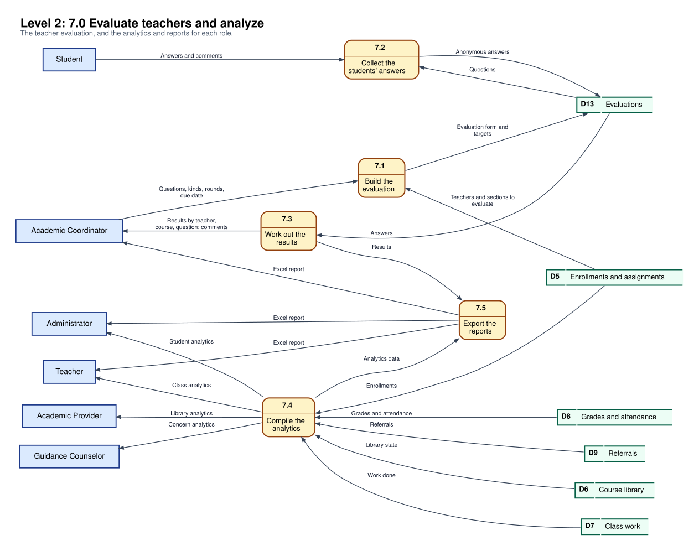
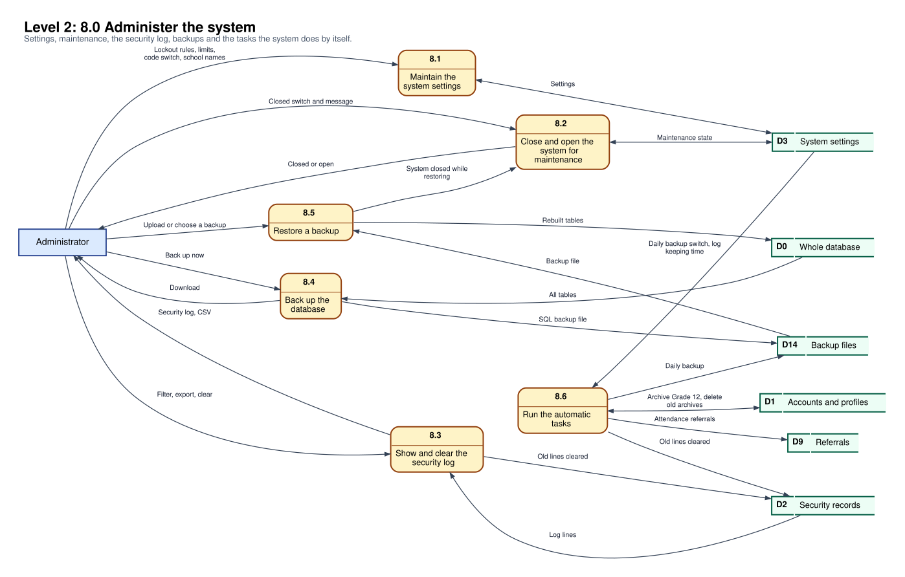

# Data flow diagrams (DFD) of the SEAITT Legazpi LMS

The diagrams below show how the data moves in the system: **level 0** (the whole system as one process), **level 1** (eight main processes) and **level 2** (each of the eight processes in its steps). They were made from the real system: the processes are the things the pages do, the data stores are the tables of the database (63 tables, see [database.md](database.md)) and the external entities are the roles and UniSMS.

> The pictures are in `docs/dfd/` as **SVG** (sharp at any size: open it in a browser and zoom) and **PNG**. To make them again after a change, edit the lists in [`dfd/make_dfd.py`](dfd/make_dfd.py) and run `python3 docs/dfd/make_dfd.py` (it needs Graphviz). The same diagrams are also published as a page that can be viewed and printed.

## How to read them (Gane-Sarson symbols)

| Symbol | Meaning | In the pictures |
|---|---|---|
| Square (blue) | **External entity**: a person or a service outside the system that gives data to it or gets data from it | Administrator, Registrar, Guidance Counselor, Academic Coordinator, Academic Provider, Teacher, Student, UniSMS, and *Any user (every role)* |
| Rounded box with a number (yellow) | **Process**: something the system does with data | `1.0` ... `8.0` in level 1; `1.1`, `1.2` ... in level 2 |
| Open-ended rectangle with an id (`D1`) and a name (green) | **Data store**: where data stays (tables of the database) | `D0` ... `D14` |
| Arrow with words | **Data flow**: what moves, and the way it goes | An arrow with two heads means the process reads **and** writes the store. A dashed arrow with no words (level 1 only) is the use of a data store: the words are in level 2 |

*Any user (every role)* means all the roles together: it is used where the same thing is true for everybody (sign-in, own settings, messages). Level 1 keeps the flows of level 0 (every flow of level 0 is in one or more processes of level 1), and each level 2 keeps the flows of its process of level 1.

## The data stores

| Id | Data store | Tables |
|---|---|---|
| D0 | Whole database | all 63 tables (for the backup) |
| D1 | Accounts and profiles | users, roles, custom_roles, administrators, registrars, guidance_counselors, academic_coordinators, academic_providers, teachers, students, profile_photos |
| D2 | Security records | security_logs, login_otps |
| D3 | System settings | system_settings |
| D4 | School structure | school_years, terms, tracks, strands, courses, strand_courses, sections |
| D5 | Enrollments and assignments | enrollments, enrollment_courses, teaching_assignments |
| D6 | Course library | material_handouts, material_items, material_questions, material_question_images, material_deliveries |
| D7 | Class work | handouts, handout_items, quiz_questions, quiz_question_images, submissions, handout_reads, handout_views, item_views |
| D8 | Grades and attendance | final_grades, attendance_records, achievement_awards |
| D9 | Referrals | referrals |
| D10 | Messages and notifications | messages, notifications, friendships, notification_sounds |
| D11 | Groups and files | study_groups, study_group_members, group_posts, stored_files, stored_file_contents, shared_files, attachments, attachment_contents |
| D12 | Calendar and announcements | announcements, calendar_entries, calendar_entry_invites, holiday_exclusions |
| D13 | Evaluations | teacher_evaluations, evaluation_questions, evaluation_targets, evaluation_responses, evaluation_answers |
| D14 | Backup files | SQL files kept in the backup folder (not a table) |

## Level 0: context diagram

One process, **0 SEAITT Legazpi LMS**, with the seven roles and UniSMS around it. The administrator is the only role that gets a login code (sent to the phone by UniSMS).

## Level 1: the main processes

| Process | What it does | Who is in it |
|---|---|---|
| **1.0 Manage accounts and access** | Checks the email and the password (the lock, the deactivated account and the maintenance switch), asks the administrator for the login code that UniSMS sends, starts and ends the session, lets the administrator manage accounts, roles and pages, and lets every person keep their own password, phone number and picture. | Any user, Administrator, UniSMS |
| **2.0 Set up the school and enroll students** | The coordinator keeps the school years, terms, tracks, strands, courses (the curriculum) and sections; the registrar enrolls students, changes an enrollment or drops a student out; the administrator assigns teachers to courses and archives or restores students (a dropped-out student goes to Archive Accounts). | Academic Coordinator, Registrar, Administrator |
| **3.0 Manage the course library** | The academic provider prepares the syllabus, the handouts and the summative exams of each course, sends them to the teachers as drafts, posts the exams to the students and tracks what was sent and posted. | Academic Provider, Teacher, Student, Academic Coordinator |
| **4.0 Conduct classes and grading** | The teacher posts handouts, gives activities and quizzes, records attendance, grades the answers and keeps the gradebook and final grades; the student opens handouts, hands in answers and quizzes and sees the grades; reading progress and achievements are kept. | Teacher, Student |
| **5.0 Handle guidance referrals** | The system finds attendance concerns by itself; the guidance counselor records concerns, writes notes and the help given, sets the schedule and marks the case as solved; the student answers (OK, Going, Not going) and can open the counselor's message again from the bell. | Guidance Counselor, Student |
| **6.0 Communicate and share** | Messages, friends and groups, stored and shared files, announcements and holidays, the calendar and the notifications (the bell). | Any user, Academic Coordinator, Teacher |
| **7.0 Evaluate teachers and analyze** | The coordinator builds the teacher evaluation, the students answer it anonymously and the results are worked out; the analytics and the Excel reports of each role are compiled from the other stores. | Academic Coordinator, Student, Administrator, Teacher, Guidance Counselor, Academic Provider |
| **8.0 Administer the system** | System settings, closing the system for maintenance, the security log, backups, restoring a backup and the tasks the system does by itself (attendance referrals, archiving Grade 12 at the end of the school year, deleting old archives, clearing old log lines). | Administrator |

## Level 2: every process in its steps

### 1.0 Manage accounts and access

| Step | Process | Notes |
|---|---|---|
| 1.1 | Check the login | Email and password; the lock, the deactivated account and the maintenance switch are checked first. |
| 1.2 | Send and check the login code | Only for an administrator, when the switch is on: the code goes to the phone through UniSMS and is checked (only a hash is kept). |
| 1.3 | Start and end the session | One sign-in at a time for an account; closing the page or the browser ends it about 3 seconds later. |
| 1.4 | Manage accounts and roles | Add, edit, deactivate or delete an account; roles and the pages of a made-up role. |
| 1.5 | Keep the own settings | Password, phone number (everybody but the administrator), picture, look and sound. |
| 1.6 | Record the security events | Sign-in, code, account and password lines of the security log. |

### 2.0 Set up the school and enroll students

| Step | Process | Notes |
|---|---|---|
| 2.1 | Maintain school years and terms |  |
| 2.2 | Maintain tracks, strands, courses and curriculum | Also from the Excel sheet of the setup. |
| 2.3 | Manage class sections | Sections and their advisers. |
| 2.4 | Enroll a student | Makes the account (email and first password from the name and the LRN) and the enrollment with the courses of the strand. |
| 2.5 | Change an enrollment or drop out | A dropped-out student has the sign-in switched off, the enrollments marked dropped and the open referrals closed, and moves to Archive Accounts. |
| 2.6 | Assign teachers to courses | Teaching assignments (one teacher for a course of a section). |
| 2.7 | Archive and restore students | Graduating students and dropped-out students; the grades are exported; an archived account is deleted 30 days later. |
| 2.8 | List and print enrollments | Student's accounts, the printable enrollment form and the Excel export. |

### 3.0 Manage the course library

| Step | Process | Notes |
|---|---|---|
| 3.1 | Maintain syllabus and handouts of the library |  |
| 3.2 | Maintain summative exams and questions |  |
| 3.3 | Send library items to the teachers | Makes a draft copy in the course of each teacher. |
| 3.4 | Post summative exams to the students | Also announces the exam to the coordinator. |
| 3.5 | Track sending and posting | Sent, posted, scheduled and hidden states; a reminder can be sent to the teachers. |

### 4.0 Conduct classes and grading

| Step | Process | Notes |
|---|---|---|
| 4.1 | Manage handouts | Post now or at a date, hide, files and slides. |
| 4.2 | Manage activities and quizzes | Items, quiz questions, due dates and settings. |
| 4.3 | Take the work (student) | Hand in an answer or take a quiz. |
| 4.4 | Grade the work and give feedback |  |
| 4.5 | Keep the gradebook and final grades | Excel export, the teacher can hide the grades from the students. |
| 4.6 | Record attendance | Weekdays only. |
| 4.7 | Track reading and achievements | The bars of the handouts and the achievement boxes. |

### 5.0 Handle guidance referrals

| Step | Process | Notes |
|---|---|---|
| 5.1 | Find concerns automatically | Attendance under 80% over at least 5 marked days, or 3 absences in a course. |
| 5.2 | Record a concern | Attendance or violation, and what happened (a list, or Others). |
| 5.3 | Write notes and help given | The list "What help did you give?" and the notes; the student gets the counselor's box. |
| 5.4 | Receive the student's answer | Seen, Ignored, Going or Not going; the student can open the message again from the bell. |
| 5.5 | Set the schedule | After the student said Going; the day goes to both calendars. |
| 5.6 | Solve the concern |  |

### 6.0 Communicate and share

| Step | Process | Notes |
|---|---|---|
| 6.1 | Send and read messages |  |
| 6.2 | Manage friends and groups |  |
| 6.3 | Store and share files | The Resources page. |
| 6.4 | Publish announcements and holidays | The coordinator, and a teacher for the own classes. |
| 6.5 | Manage the calendar | Own events and invites, with the holidays and the due dates. |
| 6.6 | Show the notifications | The bell, the counts and the sound. |

### 7.0 Evaluate teachers and analyze

| Step | Process | Notes |
|---|---|---|
| 7.1 | Build the evaluation | Questions of seven kinds, the rounds and the due date. |
| 7.2 | Collect the students' answers | Anonymous. |
| 7.3 | Work out the results | By teacher, course and question, with the comments. |
| 7.4 | Compile the analytics | For the administrator, the coordinator, the guidance counselor, the academic provider and the teacher. |
| 7.5 | Export the reports | Excel files. |

### 8.0 Administer the system

| Step | Process | Notes |
|---|---|---|
| 8.1 | Maintain the system settings | Lockout rules, limits, the code switch and the names of the school. |
| 8.2 | Close and open the system for maintenance | Only an administrator can sign in while it is closed. |
| 8.3 | Show and clear the security log | Filters, CSV export, clearing old lines. |
| 8.4 | Back up the database | A SQL file, by hand or every day. |
| 8.5 | Restore a backup | The system is closed while it is restored. |
| 8.6 | Run the automatic tasks | Attendance referrals, archiving Grade 12 at the end of the school year, deleting old archives, the daily backup and clearing old log lines. |

## Notes for the defense

- **Balancing:** the data that goes in and out of a process in level 1 is the data that goes in and out of its steps in level 2 (a flow of level 1 appears, perhaps divided in two or more, in level 2).
- **No data store is touched by an external entity directly:** a person always reaches the data through a process.
- **One system boundary:** the only service outside the system is UniSMS (the login code). Everything else (the database, the files, the background tasks) is inside.
- The picture of the database is in [database.md](database.md) (the ER diagram), and the pages that do each process are in the [README](../README.md).
